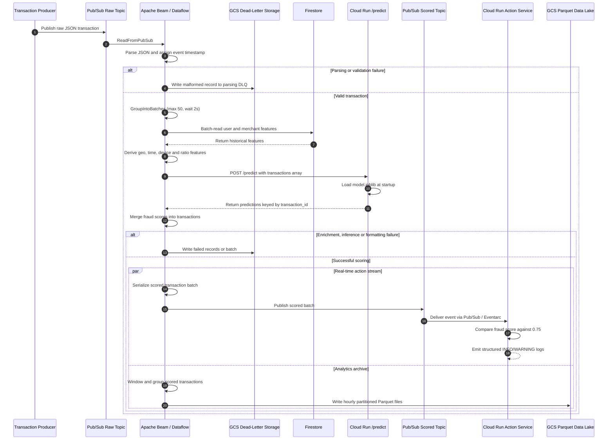

# Real-Time Fraud Detection Pipeline

A scalable, event-driven fraud detection system built on Google Cloud Platform (GCP). The pipeline ingests transaction events, enriches them with historical features, generates ML-based fraud scores, and routes results for downstream action—all within seconds.

The architecture combines real-time stream processing with batch ETL, centralized analytics, and automated feature refresh to support low-latency decisions and continuous improvement.

## 📖 Overview

This project demonstrates an end-to-end fraud detection platform built with cloud-native data engineering and machine learning services.

It follows a **hybrid processing architecture**:

- **Hot path:** Ingests, enriches, and scores transactions in near real time.
- **Cold path:** Archives transaction data, transforms it into an analytical data model, and refreshes historical features used by the real-time pipeline.

The result is a modular, scalable pipeline that connects transaction processing, ML inference, operational actions, and analytical workloads.

### Key Capabilities

- **Real-time enrichment:** Retrieve precomputed user and merchant features from Firestore.
- **ML inference:** Generate fraud predictions through a dedicated FastAPI service on Cloud Run.
- **Event-driven processing:** Use Pub/Sub to decouple ingestion, scoring, and downstream consumers.
- **Resilient execution:** Route malformed or failed records to dead-letter storage and retry transient batch-workflow failures.
- **Centralized analytics:** Store historical transaction data in BigQuery for reporting and analysis.
- **Automated feature refresh:** Use Cloud Composer and Airflow to periodically refresh the Firestore feature cache from BigQuery.

## 🎯 Project Objectives

### Business Goals

- **Reduce fraud losses** by identifying suspicious transactions before they are finalized.
- **Strengthen transaction security** and improve customer trust.
- **Enable data-driven decisions** through centralized transaction and fraud analytics.
- **Improve operational efficiency** by prioritizing high-risk transactions for investigation.

### Engineering Goals

- **Low-latency scoring:** Process transactions within seconds under suitable operating conditions.
- **Elastic scalability:** Use managed GCP services that scale with workload demand.
- **Fault isolation:** Handle malformed data, service failures, and batch-processing errors without unnecessarily interrupting the pipeline.
- **Modular architecture:** Separate streaming, ML inference, batch ETL, and orchestration.
- **Continuous improvement:** Feed historical data and refreshed features back into the real-time scoring workflow.

## 🏗️ System Architecture

The fraud detection pipeline uses a hybrid architecture that combines real-time stream processing with scheduled batch analytics. The **Hot Path** enriches and scores transactions within seconds, while the **Cold Path** archives results, loads historical data into BigQuery, and refreshes features used by the real-time pipeline.

### High-Level Design (HLD)

The HLD illustrates the major services and data flows across the real-time processing and analytical paths.

```mermaid
flowchart LR
    PG["Payment Gateway / Transaction Producer"]
    RAW[("Pub/Sub<br/>raw-transactions")]
    DF["Dataflow / Apache Beam<br/>Streaming Pipeline"]
    FS[("Firestore<br/>User & Merchant Features")]
    ML["Cloud Run<br/>FastAPI Inference Service"]
    SCORED[("Pub/Sub<br/>scored-transactions")]
    ACTION["Cloud Run<br/>Real-Time Action Service"]
    LOGS["Cloud Logging<br/>Alerts & Audit Logs"]
    GCS[("Cloud Storage<br/>Partitioned Parquet Data Lake")]
    COMP["Cloud Composer / Airflow"]
    DP["Dataproc / Spark<br/>Hourly ETL"]
    BQ[("BigQuery<br/>Data Warehouse & Feature Source")]
    EXPORT["Feature Refresh<br/>BigQuery → GCS → Firestore"]

    PG --> RAW --> DF
    DF <--> FS
    DF --> ML --> DF
    DF --> SCORED --> ACTION --> LOGS
    DF --> GCS
    GCS --> DP --> BQ
    COMP --> DP
    COMP --> EXPORT
    BQ --> EXPORT --> FS

    subgraph HOT["Hot Path — Real-Time Processing"]
        RAW
        DF
        FS
        ML
        SCORED
        ACTION
        LOGS
    end

    subgraph COLD["Cold Path — Batch Analytics"]
        GCS
        COMP
        DP
        BQ
        EXPORT
    end
```




#### HLD Architectural Notes

- **Hybrid processing:** The Hot Path handles transaction ingestion, feature enrichment, ML inference, and downstream actions. The Cold Path supports durable storage, ETL, analytics, and feature refresh.
- **Decoupled services:** Pub/Sub separates producers from consumers, while Dataflow, Cloud Run, and Dataproc scale independently according to workload.
- **Real-time feature enrichment:** Firestore provides low-latency access to precomputed user and merchant features, avoiding analytical queries against BigQuery during transaction scoring.
- **Centralized data warehouse:** BigQuery serves as the analytical source of truth for reporting, historical analysis, and feature engineering.
- **Automated feedback loop:** Cloud Composer orchestrates scheduled workflows that export refreshed features from BigQuery through GCS into Firestore.
- **Operational resilience:** Dead-letter paths, workflow retries, centralized logging, and service-account-based IAM help isolate failures and control access.

### Low-Level Design (LLD)

The LLD describes the transaction-level execution flow, including validation, micro-batching, feature enrichment, model inference, failure handling, and parallel output to downstream actions and the data lake.



#### LLD Architectural Notes

- **Ingestion and validation:** Dataflow consumes raw JSON events from Pub/Sub, validates their structure, and assigns event timestamps for event-time processing. Malformed messages are routed to a dedicated parsing dead-letter path in GCS.
- **Micro-batching:** Apache Beam's `GroupIntoBatches` groups transactions into batches of up to 50 records or a maximum wait of approximately two seconds, balancing throughput with latency.
- **Feature enrichment:** The pipeline retrieves user and merchant features from Firestore and derives additional transaction-level features, such as geographic mismatches, time-based indicators, and spending ratios.
- **Decoupled ML inference:** Dataflow sends enriched batches to the Cloud Run FastAPI `/predict` endpoint. The inference service loads the serialized model at startup and returns predictions associated with their `transaction_id`.
- **Failure isolation:** Parsing, enrichment, inference, and formatting errors are handled through dedicated dead-letter paths. Transient HTTP failures can be retried, while persistent failures are isolated for investigation.
- **Parallel output:** Successfully scored transactions are published to the scored Pub/Sub topic and independently archived as hourly partitioned Parquet files in GCS.
- **Action processing:** The Cloud Run action service evaluates each fraud score against the configured `0.75` threshold and emits structured logs. This service provides the integration point for future transaction blocking, notifications, or case management.
- **Batch processing contracts:** The hourly Airflow DAG waits for the required GCS partition before triggering Dataproc Spark ETL and loading the results into BigQuery. A separate scheduled DAG refreshes Firestore features from BigQuery through GCS.

### End-to-End Data Flow

The two paths work together to deliver low-latency fraud scoring while maintaining the historical data needed for analytics and feature engineering.

1. **Ingest:** The payment gateway publishes raw transaction events to Pub/Sub.
2. **Enrich:** Dataflow validates each event, retrieves historical features from Firestore, and derives additional model features.
3. **Score:** The enriched transaction is sent to the Cloud Run inference service, which returns a fraud score.
4. **Act and archive:** Dataflow publishes scored transactions for downstream processing and writes the results to GCS in Parquet format.
5. **Transform and warehouse:** Airflow orchestrates hourly Spark ETL on Dataproc, loading structured transaction data into BigQuery.
6. **Refresh features:** A scheduled Airflow workflow recalculates historical features in BigQuery and updates the Firestore cache through GCS.

This architecture separates latency-sensitive transaction processing from compute-intensive historical analysis, while maintaining a feedback loop between the data warehouse and the real-time feature store.

## ➡️ Data Flow

### 1. Transaction Ingestion

A payment gateway—or a simulated transaction producer—publishes a JSON event to the `raw_transactions` Pub/Sub topic.

Example:

```json
{
  "transaction_id": "txn_example_001",
  "timestamp": "2025-01-01T00:06:04Z",
  "amount": 453,
  "currency": "EGP",
  "entry_mode": "Online",
  "merchant_id": "merch_example",
  "user_id": "usr_example",
  "ip_address": "101.20.16.204",
  "device_id": "dev_example",
  "card_type": "Credit",
  "card_country": "EG",
  "was_3ds_successful": true
}
```

The event contains the transaction's core attributes. Historical context is added downstream rather than retrieved from the analytical warehouse during real-time processing.

### 2. Enrichment and ML Inference

The Dataflow streaming pipeline:

- Parses and validates incoming events.
- Retrieves precomputed user and merchant features from Firestore.
- Derives additional features, including transaction velocity, geographic distance, and amount ratios.
- Groups transactions into micro-batches to reduce API overhead.
- Calls the Cloud Run `/predict` endpoint and associates predictions with their corresponding transaction IDs.

The inference service loads the trained model at startup and returns a fraud score for each transaction.

### 3. Scoring, Actions, and Archiving

After inference, Dataflow publishes scored transactions to `scored_transactions` and archives the records to GCS.

The action service consumes scored events and evaluates their fraud scores. Independently, the archival path writes partitioned Parquet data for downstream ETL and analytics.

### 4. Batch ETL and Data Warehousing

An hourly Airflow workflow coordinates a Spark job on Dataproc. The job reads the relevant GCS partition, validates and transforms the records, and loads the resulting fact and dimension tables into BigQuery.

### 5. Analytics and Feature Refresh

BigQuery supports reporting, fraud analysis, and historical feature generation.

A scheduled Airflow workflow queries BigQuery, exports refreshed features to GCS, and loads them into Firestore. This closes the feedback loop between historical analysis and real-time scoring.

## 🧠 Core Design Concepts

### Hot Path vs. Cold Path

| Dimension | Hot path | Cold path |
|---|---|---|
| Purpose | Real-time fraud scoring | Analytics and feature engineering |
| Processing | Streaming and micro-batching | Scheduled batch processing |
| Main services | Pub/Sub, Dataflow, Firestore, Cloud Run | GCS, Dataproc, BigQuery, Composer |
| Primary output | Scored transactions and actions | Historical tables and refreshed features |
| Priority | Low latency | Throughput and analytical consistency |

### Decoupled Services

Each major component has a defined responsibility and communicates through APIs or messaging interfaces.

This separation enables independent deployment and scaling, simplifies maintenance, and helps isolate failures. The inference service can evolve independently of the streaming pipeline, provided its API contract remains compatible.

### Micro-Batching

The streaming pipeline uses Apache Beam's `GroupIntoBatches` transform to balance throughput and latency.

For example, a batch may be emitted when it reaches 50 transactions or after a maximum wait of two seconds, depending on the configured transform. Batching reduces HTTP overhead and can improve inference efficiency.

### Resilience and Dead-Letter Handling

- **Parsing failures:** Preserve malformed input in a dedicated GCS dead-letter path.
- **Processing failures:** Capture failed enrichment or inference batches for investigation or replay.
- **Transient failures:** Apply appropriate retries to service requests and orchestration tasks.
- **Batch dependencies:** Check for source-data availability before launching expensive ETL jobs.
- **Monitoring:** Centralize service and workflow logs in Cloud Logging and configure failure notifications where required.

## 💻 Technology Stack

| Category | Technologies | Purpose |
|---|---|---|
| Cloud platform | Google Cloud Platform | Managed infrastructure and execution |
| Messaging | Pub/Sub | Transaction ingestion and event distribution |
| Stream processing | Dataflow, Apache Beam | Real-time enrichment and scoring orchestration |
| Batch processing | Dataproc, Apache Spark | Scheduled ETL |
| Data lake | Cloud Storage, Parquet | Durable, partitioned transaction storage |
| Data warehouse | BigQuery | Analytics, reporting, and historical features |
| Feature cache | Firestore | Low-latency user and merchant lookups |
| ML serving | Cloud Run, FastAPI | Model inference API |
| ML development | Scikit-learn, XGBoost, Optuna | Training, classification, and hyperparameter tuning |
| Experiment tracking | Weights & Biases | Experiment metrics and artifact tracking |
| Serialization | Joblib | Model artifact persistence |
| Orchestration | Cloud Composer, Apache Airflow | Scheduling, retries, and workflow monitoring |
| Deployment | Docker, Cloud Build, Artifact Registry | Container builds and image management |
| Event integration | Eventarc | Event-driven service invocation |
| Programming language | Python | Pipeline, ML, API, and automation code |

**Data formats:** JSON for events and API payloads; Parquet for partitioned analytical storage; YAML for workflow configuration.

## 📂 Repository Structure

```text
real-time-fraud-detection-pipeline/
├── data_pipelines/
│   ├── batch/
│   │   └── transactions_etl_to_dwh/
│   └── streaming/
│       ├── processing_pipeline/
│       └── real_time_action/
├── machine_learning/
│   ├── inference_service/
│   └── training_pipeline/
├── orchestration/
│   ├── dags/
│   ├── plugins/
│   ├── data/
│   └── docker-compose.yaml
├── scripts/
│   ├── deployment/
│   └── local/
└── templates/
    └── transactions_etl_workflow.yaml
```

### Key Components

- **`data_pipelines/streaming/processing_pipeline/`** — Apache Beam pipeline for Pub/Sub ingestion, Firestore enrichment, ML inference, and downstream publishing.
- **`data_pipelines/streaming/real_time_action/`** — Cloud Run service for evaluating scored transactions and emitting operational logs.
- **`data_pipelines/batch/transactions_etl_to_dwh/`** — Spark ETL job that transforms GCS data into BigQuery fact and dimension tables.
- **`machine_learning/training_pipeline/`** — Model training, preprocessing, hyperparameter optimization, and experiment tracking.
- **`machine_learning/inference_service/`** — FastAPI application that loads the trained model and exposes `/predict`.
- **`orchestration/dags/`** — Airflow workflows for hourly warehouse loads and scheduled feature refreshes.
- **`orchestration/plugins/`** — Custom Airflow operators, including GCS-to-Firestore loading functionality.
- **`scripts/deployment/`** — Scripts for configuring GCP resources and deploying application components.
- **`scripts/local/`** — Helpers for local development and testing.
- **`templates/`** — Reusable Dataproc workflow configuration.

## 🤖 Infrastructure and Deployment

Deployment automation is organized under `scripts/deployment/`, with separate scripts for foundational configuration and individual application components.

Typical responsibilities include:

- **Permissions and setup:** Configure service accounts, IAM roles, and required cloud resources.
- **ML inference:** Build and publish the inference container, then deploy it to Cloud Run.
- **Streaming pipeline:** Package and deploy the Dataflow job with its runtime configuration.
- **Batch ETL:** Upload the Spark application and register the Dataproc workflow template.
- **Real-time actions:** Deploy the action service and configure event-driven invocation.
- **Orchestration:** Create, manage, and deploy DAGs and plugins to Cloud Composer.

Use the deployment scripts and configuration files in the repository as the source of truth for exact commands, required parameters, and environment-specific settings.

## 🔭 Future Work

The following improvements would strengthen the project's production readiness.

### Infrastructure as Code

Adopt Terraform to define GCP resources declaratively, manage infrastructure state, review planned changes, and create consistent development, staging, and production environments.

### CI/CD Automation

Introduce GitHub Actions or an equivalent CI/CD platform to automate:

- Code formatting, linting, and static checks.
- Unit and integration tests for pipelines, DAGs, and API services.
- Container builds and artifact publishing.
- Staging deployments and end-to-end validation.
- Controlled promotion to production.

### Additional Production Enhancements

- Add comprehensive integration and failure-recovery tests.
- Establish service-level objectives for latency, availability, and processing throughput.
- Improve observability with metrics, dashboards, and actionable alerts.
- Add model-quality monitoring and a governed retraining and deployment workflow.
- Validate idempotency, replay behavior, and data consistency across pipeline stages.
